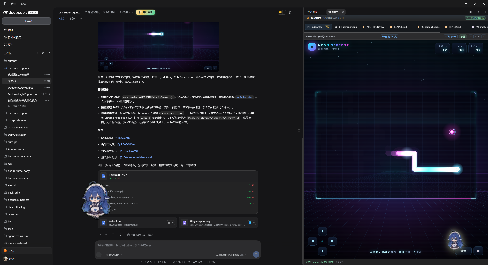
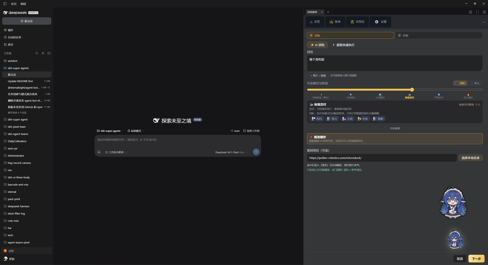
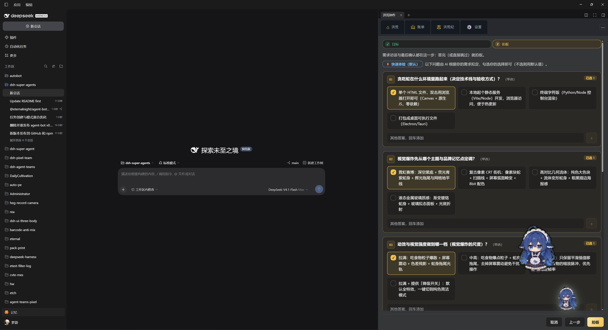
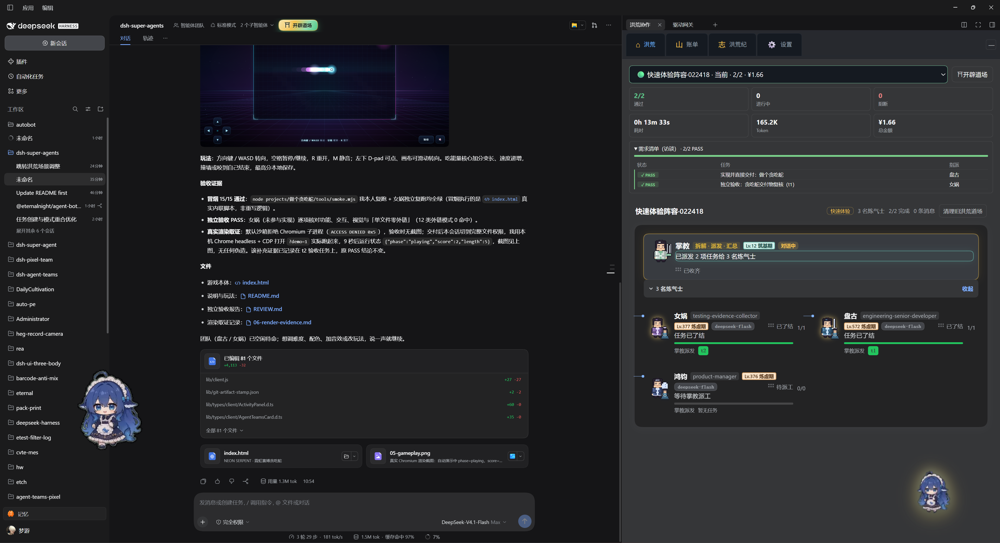
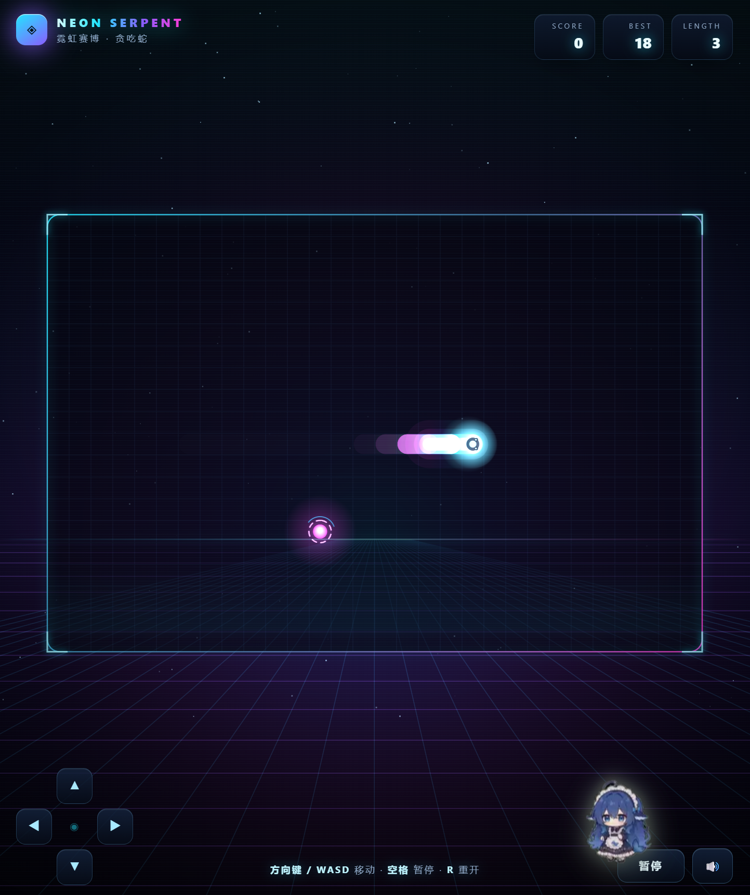
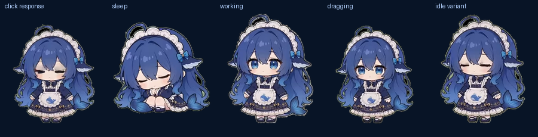
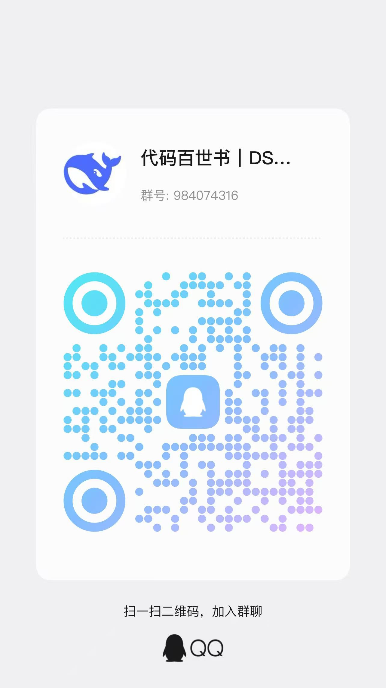

<h1 align="center">
  
  <br/>
  agent-bot
</h1>

<p align="center"><b>A desk pet that ships, and the team that ships with it</b></p>

<p align="center">
  <a href="https://github.com/EternalNight996/agent-bot/stargazers"></a>&nbsp;
  <a href="https://www.npmjs.com/package/@eternalnight/agent-bot"></a>&nbsp;
  <a href="https://github.com/EternalNight996/agent-bot/releases"></a>&nbsp;
  <a href="LICENSE"></a>
</p>

**English (default)** · [简体中文（镜像）](README_ZH.md)

<p align="center">
  
</p>
<p align="center"><sub>▲ Delivery in place — the driver gateway runs the shipped artifact while the chat keeps its verification evidence</sub></p>

> **Your agents don't need another dashboard. They need a place to finish work and show it to you.**
>
> Approve the plan → the captain splits tasks → members deliver against contracts → an independent review gates it → the artifact runs right where you can see it. Local-first, MIT, no cloud account.

- 🔍 **Review before it runs** — members, tasks, dependencies and acceptance are confirmed before anything is created or dispatched.
- 🧾 **Delivery is evidence** — every acceptance item carries a verify command the host re-runs itself; an implementer can never approve its own work.
- 🖼 **Artifacts open in place** — pages run inside the panel, images render, source is readable. No setup, no local server.
- 🏯 **A sidebar that stays out of the way** — collapse it into a draggable token and call it back with one click.
- 🐳 **A pet on your desktop** — transparent, always-on-top, draggable; it idles, eats, plays, sleeps, works, and double-click brings DSH forward.
- 🔒 **Local-first** — team state lives in `.agent-teams/` inside your workspace; nothing syncs behind your back.

<p align="center"><strong>⭐ If it saves you one round of installing, serving and screenshotting, a star helps a lot.</strong><br/><sub>DSH one-liner: <code>dsh plugin --profile desktop add @eternalnight/agent-bot</code></sub></p>

## ⚡ Quick start

**1. Install into DeepSeek Harness (team panel)**

```powershell
dsh plugin --profile desktop add @eternalnight/agent-bot
# reopen DSH → the team panel lives in the right sidebar
```

Then walk the smallest loop:

1. Click **Create team** (or collapse the panel into the token and click it) — fill in the goal, mode, acceptance and lineup;
2. Answer the **requirements interview** and press **Decide** (拍板);
3. **Review the plan first** — members, tasks, dependencies and acceptance stay visible; nothing is created before you approve;
4. Watch it work: click a member to open their session, click the level badge for gear, and when delivery lands the **driver gateway** runs the artifact for you.

**2. Install the desktop pet (end users)**

Download `DSH-Pet-Setup-<version>.exe` from [Releases](https://github.com/EternalNight996/agent-bot/releases):

- installs per-user into `%LOCALAPPDATA%\Programs\DSH Pet`, **no admin rights**;
- creates a desktop shortcut by default, optional launch-at-login, uninstalls from Settings like any app;
- single instance: autostart plus shortcut still ends up as one pet.

**3. Run the pet from source (developers)**

```powershell
# easiest: ships its own runtime, no separate Python / Pillow install
.\desktop-pet\start-pet.cmd

# equivalent (prefers the DSH bundled Python, falls back to system pythonw)
& "$env:USERPROFILE\.dsh\dsh-runtimes\dsh-primary-runtime\dependencies\python\python.exe" desktop-pet\pet.py --workspace .

# self-check / reset the save file
python desktop-pet\pet.py --check --workspace .
python desktop-pet\pet.py --reset
```

> Runs for real (2026-11-05): `pet.py --check --workspace .` exits 0 with `{"ok": true, "level": 2, "stage": "fry", "frames": 16, ...}` (`completedTasks` follows finished work, so it is not pinned). The desktop app and the DSH pet share the same rules but keep separate saves.

## 📸 Screenshots

Every image below is the current build on a real machine (Windows 11 · DSH desktop, captured 2026-11-05), copied verbatim into `assets/screenshots/` — **not beautified, not stitched, not redrawn**. The previous `assets/readme/*.webp` showcase set has been removed.

<p align="center">
  
  
</p>
<p align="center"><sub>▲ ① Goal “make a snake game” · mode and lineup · visual explosion — ② the AI drafts interview questions (runtime, theme, motion), you tick and decide</sub></p>

<p align="center">
  
</p>
<p align="center"><sub>▲ ③ Delivery — the driver gateway runs the freshly delivered artifact; the chat keeps the smoke result, the independent review and the real-render evidence</sub></p>

<p align="center">
  
  
</p>
<p align="center"><sub>▲ ④ Result: 2/2 passed · 0 blocked · 13m33s · 165.2K tokens · ¥1.66 　⑤ The artifact: NEON SERPENT</sub></p>

<p align="center">
  
  
  
</p>
<p align="center"><sub>▲ Desk pet — main window (character only, no bubbles or stat panels) · first launch · the draggable token after collapsing the sidebar</sub></p>

<p align="center">
  
</p>
<p align="center"><sub>▲ Five frames: click response · sleep · working · dragging · idle variant</sub></p>

## 🐍 One real delivery: from “make a snake game” to playable

These captures come from a single real task, not a mock-up:

| Step | Image | What happened |
| --- | --- | --- |
| 1 | `任务目标.png` | Goal set to “make a snake game”; development mode and lineup picked; optional visual explosion and optional remake-project reference |
| 2 | `任务拍板.png` | The AI drafts the requirements interview — runtime, visual theme, motion intensity — you tick answers and **decide** |
| 3 | Plan review | Members, tasks, dependencies, acceptance and verify commands are laid out; **nothing is created before approval** |
| 4 | `任务交付.png` | The captain dispatches, members deliver; the driver gateway runs the artifact with smoke result, independent review and render evidence attached |
| 5 | `交付结果.png` / `交付demo.png` | The team page reports 2/2 passed, 0 blocked; the artifact itself is a playable snake game |

> The numbers inside the images are that one run (13m33s · 165.2K tokens · ¥1.66). Your tasks will differ — this is a record, not a promise.

## 🖥 The desk pet

The desktop window shows **the character only**: no bubbles, no buttons, no always-on stat panel.

| Action | Effect |
| --- | --- |
| Left click | Pet it: mood +7, XP +2, a heart pops |
| Left drag | Move it anywhere on screen (position is remembered and clamped on-screen) |
| Double click | Wake DSH and open the right sidebar home; launches DSH if it is not running |
| Right click | Feed / play / pet / rest (10 minutes) / behavior preview / open DSH / status / quit |
| Hotkeys | F feed · P play · M pet · R rest · S status · D open DSH |

Full stats, the growth bar and four interaction buttons live in DSH → Settings → Pet; the desktop stays clean.

**Growth and saves**

- Satiety decays over time; at zero, mood decays faster. Energy recovers slowly; right-click → Rest sleeps for 10 minutes, click to wake early.
- Feed +26 satiety / +6 XP; play +18 mood / +8 XP; pet +2 XP.
- Each finished team task (read from `.agent-teams/**/team.json` in the workspace) grants +12 XP and +4 mood.
- Stages: Lv1-2 → Lv3-4 → Lv5-7 → Lv8+, the body grows with it; offline time is settled up to 12 hours.
- Save file: `%APPDATA%\dsh-pet\state.json`.

## 🏯 Right sidebar panels

Six clickable panels, identical entry points in the desktop app and inside DSH:

| Panel | What it does |
| --- | --- |
| **Workspace · roster** | Current team, past teams and member entry points |
| **Task board · progress** | Task dependencies, dispatch progress, verification evidence |
| **Library · guidelines** | Members, task contracts, plan drafts, the founding wizard; **Show** previews artifacts in place |
| **Gear · list** | Artifact / mount / skill cabinet, previewed inside the panel |
| **Team board · names** | Member levels, growth cards, level-up notes, team story |
| **About** | Support, community, about, and a feedback form with a privacy boundary |

Plus **Post · inbox**: the captain's mailbox, keyboard reachable, body escaped. The fixture wall and the bottom bar are two doors to the same panels; collapse the panel into the draggable token and click it to bring the sidebar back.

## 🧾 Delivery gates

| Signal | Evidence |
| --- | --- |
| Full suite | `pnpm verify` exits 0 |
| Browser-side contract | `pnpm verify:web-routes` passes |
| Release artifact | Package smoke test checks runtime and support QR codes, excludes source / tests / docs |
| A real team run | Captain dispatches → members write → independent review → synthesis (covered by the full suite) |
| Isolation | An implementer cannot approve its own implementation |

This is a tool for **parallel wall-clock time plus independent verification**, not a promise that every task gets cheaper; for small tasks a single agent is usually the better deal.

## 🎛 Quality gate configuration

The plugin config field `quality` controls how gates are audited:

| Option | Default | Effect |
| --- | --- | --- |
| `autoVerify` | `true` | The host re-runs every declared `verify` command before accepting a finished quality task |
| `autoReview` | `false` | Completes ready review tasks automatically once gates, acceptance and host commands pass |
| `requireAcceptance` | `true` | Automatic review requires every acceptance item of the reviewed task to pass |
| `autoDetect` | `true` | Detects the generated project's own `package.json` test / typecheck scripts and runs them too |
| `reviewMode` | `"auto"` | `auto`: the host closes it; `human`: the host stops at “awaiting human review” |
| `commands` | `["git diff --check"]` | Fallback verify commands for generated projects, not inherited from the plugin |
| `commandsByProject` | `{}` | Verify commands per project root |
| `verifyTimeoutMs` | `120000` | Host timeout per verify command |

Every field is optional; omit it and the default applies (omit `quality` entirely and nothing is overridden).

```yaml
quality:
  autoReview: true
  reviewMode: "human"   # stop at “awaiting human review” after the host passes
  commandsByProject:
    "projects/snake": ["node projects/snake/smoke.mjs"]
```

## 🧩 Roles and templates

Lineups are picked by “what happens next”; the seat cap is 5, and idle roles spend no tokens. Six task lineups ship today (defined in `src/client/lineup-store.ts`, display names from `src/agency-role-seeds.ts`):

| Lineup | Roles (id → display name) | Good for |
| --- | --- | --- |
| **Direct delivery** | `product-manager` PM · `engineering-senior-developer` senior developer · `testing-evidence-collector` evidence collector · `engineering-code-reviewer` code reviewer | Fewest detours, straight to the task |
| **Bug fix** | `engineering-codebase-onboarding-engineer` onboarding engineer · `engineering-senior-developer` senior developer · `testing-evidence-collector` evidence collector | Understand the code, then locate and fix |
| **Full-stack feature** | `product-manager` PM · `engineering-frontend-developer` frontend developer · `engineering-backend-architect` backend architect · `testing-evidence-collector` evidence collector · `engineering-code-reviewer` code reviewer | Contract first, front and back in parallel (all 5 seats) |
| **Read-only audit** | `engineering-codebase-onboarding-engineer` onboarding engineer · `engineering-code-reviewer` code reviewer · `testing-evidence-collector` evidence collector · `engineering-technical-writer` technical writer | Touch nothing, only gather evidence |
| **Performance** | `product-manager` PM · `engineering-senior-developer` senior developer · `testing-performance-benchmarker` performance benchmarker · `engineering-devops-automator` DevOps automator | Metrics first, conclusions backed by data |
| **Security** | `security-appsec-engineer` AppSec engineer · `security-cloud-security-architect` cloud security architect · `engineering-devops-automator` DevOps automator · `testing-evidence-collector` evidence collector | Reproduce first, minimal diff |

Six mode presets are generated from development modes as well (e.g. “quick experience lineup”, “standard delivery lineup”), plus twelve founding templates: **direct delivery / bug fix / new feature / research / audit / full-stack / hardening / build / refactor / docs / design review / short drama** (`quickstart.tpl*` in `src/client/locales.ts`).

Every role gets a fixed contract: ownership, must / must-not, done criteria, a five-point report and a budget. The full-stack lineup keeps all 5 seats on purpose: one less handoff.

## 🧠 How it works

- A captain-owned task graph with dependency-aware dispatch;
- durable member sessions, mailboxes and attempt ownership;
- quality contracts: objective, scope, acceptance, verify, verdict;
- independent verification / review gates, repair rounds, cold recovery;
- contracts split by role, so frontend / backend / integration each own their layer;
- team state under `.agent-teams/<teamId>/` — inspectable, local, yours.

## 🔒 Boundaries

- No hidden cloud sync: growth and feedback diagnostics stay local.
- Approval is explicit: a plan draft starts nothing before you approve it.
- Deployment needs a clear confirmation: agents never quietly replace a running session.
- Review is independent: an implementer cannot approve its own implementation.

## 🧭 Where this could go

Directional notes referenced against [OpenMausBot](https://github.com/milind-soni/OpenMausBot), **every row sourced**, not a roadmap promise.
> Sourcing note: this machine cannot reach `github.com` / `raw.githubusercontent.com` (repeated `fetch failed`), so the evidence below comes from the project's public metadata, PR / commit titles and documentation-index titles, not from verbatim README quotes. Mirror when GitHub is blocked: [AtomGit · OpenMausBot](https://atomgit.com/GitHub_Trending/op/OpenMausBot).

| # | Direction | Landing here | Source (all derived from https://github.com/milind-soni/OpenMausBot ) |
| --- | --- | --- | --- |
| 1 | Give the bot a real VM desktop (computer use) | The pet is the display layer today; next, members click, drag and verify artifacts on a real desktop | [repo](https://github.com/milind-soni/OpenMausBot) description: “Open-source Grok Bot alternative with a virtual machine that bots can use” |
| 2 | A local VM: the bot drives a Linux desktop on this machine | Delivery preview grows from read-only into interactive machine operation | [PR #87](https://github.com/milind-soni/OpenMausBot/pull/87) “Local VM: a bot can drive a Linux desktop on this machine” |
| 3 | Use Cua Driver for local VM computers | Reuse the driver layer instead of building one | [commit aa39a82](https://github.com/milind-soni/OpenMausBot/commit/aa39a82f93b0de70abd4ebcf13cae7c5c4363256) “Use Cua Driver for local VM computers” |
| 4 | computer use / browser use as its own capability doc | `pnpm verify:web-routes` can grow into agent-driven click-through checks | [docs/computer-use-integration.md](https://github.com/milind-soni/OpenMausBot/blob/main/docs/computer-use-integration.md) |
| 5 | Multi-agent chat experience | Benchmarks member sessions and chat interaction | [AtomGit mirror](https://atomgit.com/GitHub_Trending/op/OpenMausBot) summary: “TypeScript/React/Electron AI multi-agent chat app” |
| 6 | Self-hosted / containerised deployment | Local-first today; headless and Docker scripts next | [repo topics](https://github.com/milind-soni/openmausbot): `self-hosted`, `docker` |
| 7 | Desktop shell and mobile | The pet is a standalone tkinter process today; direction is one unified desktop shell | [repo topics](https://github.com/milind-soni/openmausbot): `electron`, `expo` |
| 8 | Align with more executor ecosystems | The role executor abstraction extends to more backends | [repo topics](https://github.com/milind-soni/openmausbot): `claude-code`, `codex` |

> License note: OpenMausBot is Apache-2.0, this project is MIT — mind the difference when borrowing code.

## 🛠 Development

```powershell
pnpm install
pnpm typecheck
pnpm build
pnpm verify
pnpm verify:web-routes
```

After a fresh clone run `pnpm build` before `pnpm verify`: `lib/client/` intermediates and `*.map` files are generated and stay out of git. DSH lifecycle skills are resolved live from the shared memory vault and are not vendored here.

## 📚 Documentation & links

- [CONTRIBUTING.md](CONTRIBUTING.md) · [CHANGELOG.md](CHANGELOG.md) · [compatibility.json](compatibility.json)
- [IP and attribution](NOTICE.md) · [Sponsorship (optional, changes nothing)](SPONSOR.md)
- Issues: https://github.com/EternalNight996/agent-bot/issues
- Releases: https://github.com/EternalNight996/agent-bot/releases

## 💬 Community

**Questions, ideas, or DSH plugin talk — join the groups:**

| QQ group | WeChat group |
|:---:|:---:|
|  |  |

**Buy the author a coffee (optional):**

| WeChat Pay | WeChat Reward |
|:---:|:---:|
|  |  |

> Sponsorship is optional and changes nothing; the plugin stays MIT and free. See [SPONSOR.md](SPONSOR.md).

## 📄 License

MIT © 2026 Huizhou Mengyou Technology Co., Ltd. Terms and attribution in [NOTICE.md](NOTICE.md) and [LICENSE](LICENSE). The sidebar panel UI, the delivery governance layer and the desk pet are original to this project.

**If you want this team to keep growing, leave a star.**
