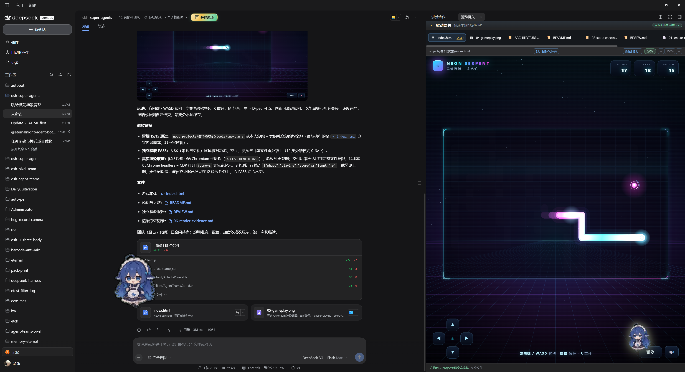
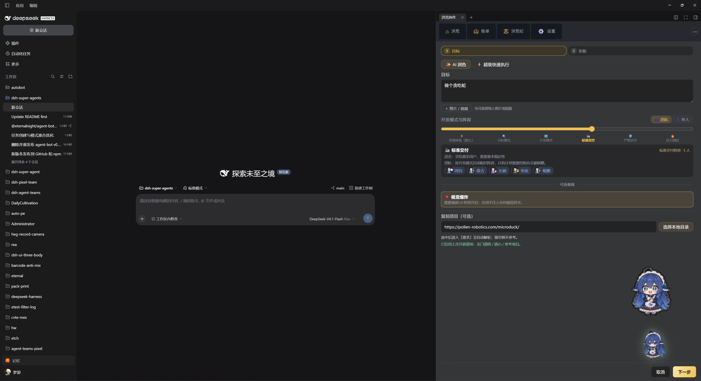
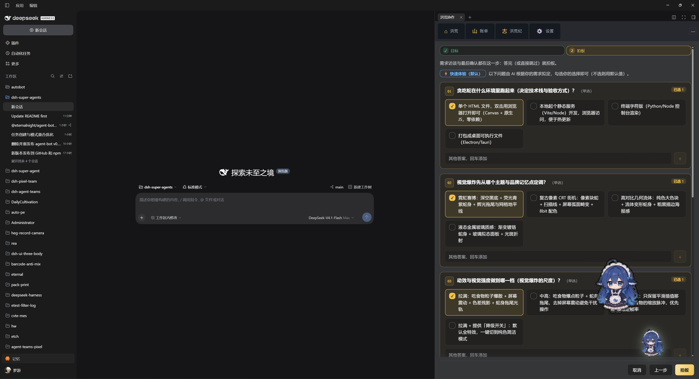
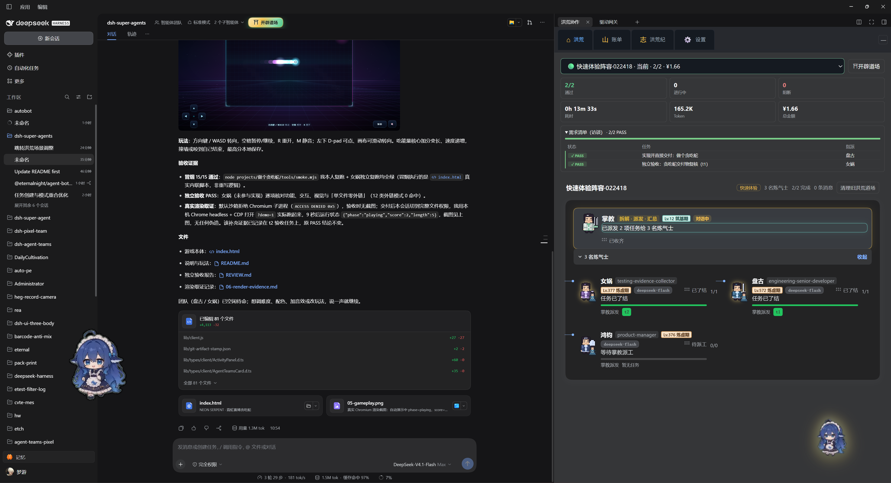
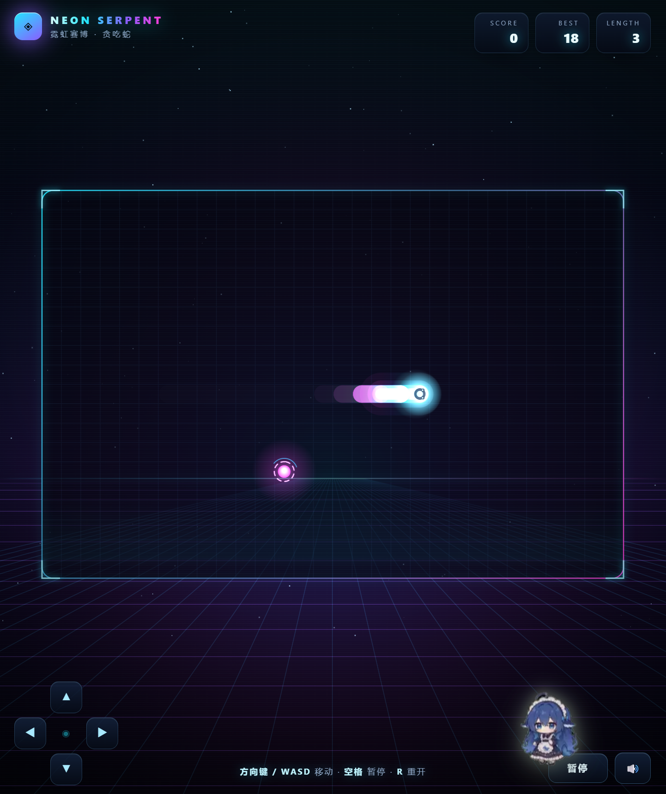
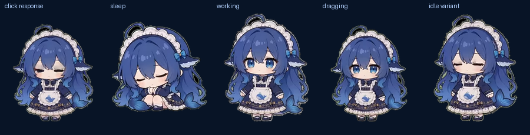
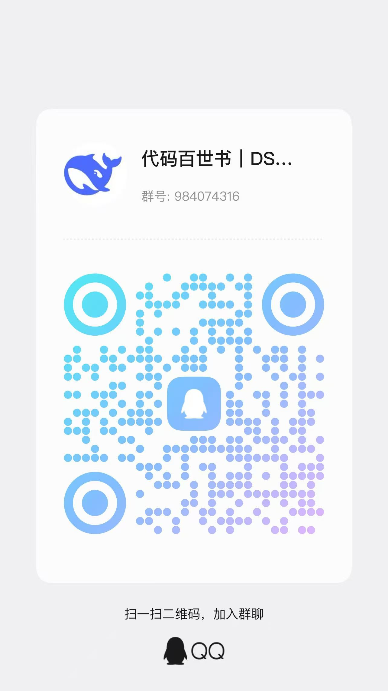

<h1 align="center">
  
  <br/>
  agent-bot
</h1>

<p align="center"><b>小肥鱼桌宠 + 会交付的 AI 团队</b></p>

<p align="center">
  <a href="https://github.com/EternalNight996/agent-bot/stargazers"></a>&nbsp;
  <a href="https://www.npmjs.com/package/@eternalnight/agent-bot"></a>&nbsp;
  <a href="https://github.com/EternalNight996/agent-bot/releases"></a>&nbsp;
  <a href="LICENSE"></a>
</p>

[English (default)](README.md) · **简体中文（镜像）**

<p align="center">
  
</p>
<p align="center"><sub>▲ 交付现场：右侧「驱动网关」当场跑起刚交付的生产物，左侧是同一件活儿的验收证据</sub></p>

> **你的智能体不缺仪表盘，缺一个能把活干完、还能把产物摆到你眼前的地方。**
>
> 批准计划 → 队长拆任务 → 成员按契约交付 → 独立审查 → 产物就地跑起来。本地优先、MIT、不需要云账号。

- 🔍 **先审后跑** —— 成员、任务、依赖、验收都确认后才创建、才派发；批准之前不启动任何东西。
- 🧾 **交付靠证据** —— 每条验收都有验证命令，宿主会**自己复跑**；实现者不能批准自己的实现。
- 🖼 **产物当场打开** —— 网页在面板内直接跑、图片直接渲染、源码可直接读，不用你装环境、起服务。
- 🏯 **右侧栏常驻** —— 收起后是一枚可拖令牌，挡住对话就收起来，点一下就能叫回来。
- 🐳 **桌面上还有一只宠物** —— 透明、置顶、可拖动；会待机、进食、玩耍、睡觉、干活，双击把 DSH 唤醒。
- 🔒 **本地优先** —— 团队状态在你自己工作区的 `.agent-teams/`；没有隐藏的云同步。

<p align="center"><strong>⭐ 如果它替你省下一次「装环境、起服务、再截图」的功夫，点个 Star 就够了。</strong><br/><sub>DSH 一行安装：<code>dsh plugin --profile desktop add @eternalnight/agent-bot</code></sub></p>

## ⚡ 快速开始

**一、装进 DeepSeek Harness（团队面板）**

```powershell
dsh plugin --profile desktop add @eternalnight/agent-bot
# 重开 DSH，右侧栏就是团队面板
```

然后走一遍最小闭环：

1. 点 **组建团队**（或把面板收起成令牌再点它）—— 填目标、开发模式、验收与阵容；
2. **需求访谈**里勾选你的选择，点 **拍板**；
3. **先审计划**：成员、任务、依赖、验收都看清楚再批准，批准前不会创建任何东西；
4. 看它跑起来：点成员打开他的会话，点等级徽章看装备，交付时 **驱动网关** 会把产物直接跑给你看。

**二、装上桌面宠物（普通用户）**

到 [Releases](https://github.com/EternalNight996/agent-bot/releases) 下载 `DSH-Pet-Setup-<version>.exe`：

- 按用户安装到 `%LOCALAPPDATA%\Programs\DSH Pet`，**不需要管理员权限**；
- 默认创建桌面快捷方式，可选开机自启，可从「控制面板 / 设置」正常卸载；
- 单实例：开机自启和桌面快捷方式同时存在也不会出现两只。

**三、从源码跑宠物（开发者）**

```powershell
# 最省事：自带运行时，不需要另装 Python / Pillow
.\desktop-pet\start-pet.cmd

# 等价命令（优先使用 DSH 内置 Python，找不到时回退系统 pythonw）
& "$env:USERPROFILE\.dsh\dsh-runtimes\dsh-primary-runtime\dependencies\python\python.exe" desktop-pet\pet.py --workspace .

# 自检 / 复位存档
python desktop-pet\pet.py --check --workspace .
python desktop-pet\pet.py --reset
```

> 主流程已实跑（2026-11-05）：`pet.py --check --workspace .` 退出码 0，输出 `{"ok": true, "level": 2, "stage": "fry", "frames": 16, ...}`（`completedTasks` 随任务完成数变化，不写死）。桌面端与 DSH 内是同一套养成规则，存档各自独立。

## 📸 实机截图

全部为当前版本真机画面（Windows 11 · DSH 桌面端，2026-11-05 采集），原样拷贝到 `assets/screenshots/`，**未美化、未拼接、未重绘**。上一代 `assets/readme/*.webp` 展示图已全部删除。

<p align="center">
  
  
</p>
<p align="center"><sub>▲ ① 目标「做个贪吃蛇」· 开发模式/阵容 · 视觉爆炸 —— ② AI 按目标拟访谈题（运行环境 / 主题 / 动效强度），勾选后拍板</sub></p>

<p align="center">
  
</p>
<p align="center"><sub>▲ ③ 交付：驱动网关里直接跑起刚交付的产物，左侧是冒烟结果、独立验收与真实渲染证据</sub></p>

<p align="center">
  
  
</p>
<p align="center"><sub>▲ ④ 交付结果：2/2 通过 · 0 阻断 · 13m33s · 165.2K token · ¥1.66 　⑤ 产物本体：NEON SERPENT（霓虹赛博 · 贪吃蛇）</sub></p>

<p align="center">
  
  
  
</p>
<p align="center"><sub>▲ 桌面宠物：主界面（只有角色本体，没有气泡和数值面板） · 首次启动 · 收起右侧栏后的可拖令牌</sub></p>

<p align="center">
  
</p>
<p align="center"><sub>▲ 五格依次为 点击回应 · 睡觉 · 工作 · 拖拽 · 待机变体</sub></p>

## 🐍 一次真实交付：从「做个贪吃蛇」到能玩

下面这组图是同一次真实任务的全过程，不是示意图：

| 步骤 | 画面 | 发生了什么 |
| --- | --- | --- |
| 1 | `任务目标.png` | 目标写「做个贪吃蛇」，选开发模式与阵容；可选打开「视觉爆炸」，也可填「复刻项目」让 AI 先解析参考 |
| 2 | `任务拍板.png` | AI 按目标拟出需求访谈：运行环境、视觉主题、动效强度…… 勾选后 **拍板** |
| 3 | 计划审核 | 成员、任务、依赖、验收、验证命令全部先摊开给你看，**批准前不创建任何东西** |
| 4 | `任务交付.png` | 队长派发，成员交付；驱动网关里直接跑起产物，左侧附冒烟结果、独立验收与渲染证据 |
| 5 | `交付结果.png` / `交付demo.png` | 团队页汇总 2/2 通过、0 阻断；产物本体是一份可以直接玩的贪吃蛇 |

> 图内数值是这一次运行的真实记录（13m33s · 165.2K token · ¥1.66），不同任务会有差异，不是承诺。

## 🖥 桌面宠物

桌面窗口**只显示角色本体**：没有气泡、按钮和常驻数值面板。

| 操作 | 效果 |
| --- | --- |
| 左键单击 | 摸摸，心情 +7、经验 +2，冒一颗心 |
| 左键拖动 | 拖到桌面任意位置（位置会记住并夹在屏幕内） |
| 双击 | 唤醒 DSH 并展开右侧栏到首页；DSH 没启动时自动启动 |
| 右键 | 喂食 / 陪玩 / 摸摸 / 休息（睡 10 分钟）/ 动作预览 / 打开 DSH / 查看状态 / 退出 |
| 快捷键 | F 喂食 · P 陪玩 · M 摸摸 · R 休息 · S 查看状态 · D 打开 DSH |

完整数值、成长条和四个互动按钮在 DSH 的「设置 → 宠物」页；桌面端保持干净。

**养成与存档**

- 饱食度随时间下降，饿到 0 时心情下降更快；精力缓慢恢复，右键「休息」进入 10 分钟睡眠，点击可提前唤醒。
- 喂食 +26 饱食 / +6 经验；陪玩 +18 心情 / +8 经验；摸摸 +2 经验。
- 每完成 1 个团队任务（读取工作区 `.agent-teams/**/team.json`），宠物 +12 经验、+4 心情。
- 阶段：Lv1-2 → Lv3-4 → Lv5-7 → Lv8+，体型跟着变大；离线最多结算 12 小时。
- 存档位置：`%APPDATA%\dsh-pet\state.json`。

## 🏯 右侧栏面板

右侧栏是六个可点面板，桌面端与 DSH 端入口一致：

| 面板 | 现在做什么 |
| --- | --- |
| **工作台·名册 / Workspace · roster** | 当前团队、历史团队与成员入口 |
| **任务板·进度 / Task board · progress** | 任务依赖、派发进度、验证证据 |
| **资料库·协作准则 / Library · guidelines** | 成员、任务契约、计划草案、组建向导；「展示」按钮就地预览交付物 |
| **装备库·清单 / Gear · list** | 装备柜：法器 / 坐骑 / 技能，立即在面板内预览 |
| **排行榜·留名 / Team board · names** | 成员等级、成长卡、升级提示、团队故事 |
| **关于 / About** | 支持、社区、关于，以及带隐私边界的反馈表单 |

另有 **收件箱·消息 / Post · inbox**：队长信箱，可键盘到达、正文转义。面板墙和底部栏是同一批面板的两条入口；收起后变成可拖令牌，点击令牌可把右侧栏叫回来。

## 🧾 交付门禁

| 信号 | 证据 |
| --- | --- |
| 全量套件 | `pnpm verify` 退出码 0 |
| 浏览器侧契约 | `pnpm verify:web-routes` 通过 |
| 发布产物 | 包冒烟检查运行时与支持二维码，排除源码 / 测试 / 文档 |
| 真实团队跑 | 队长派发 → 成员写入 → 独立审查 → 汇总（由全量套件覆盖） |
| 隔离 | 实现者不能批准自己的实现 |

这是给**并行墙钟 + 独立验证**用的工具，不是「每个任务都更便宜」的承诺；小任务通常一个智能体更划算。

## 🎛 质量门禁配置

插件配置字段 `quality` 控制门禁如何审计：

| 选项 | 默认 | 作用 |
| --- | --- | --- |
| `autoVerify` | `true` | 宿主在接收完成的质检任务前，复跑每条声明的 `verify` 命令 |
| `autoReview` | `false` | 所有门禁、目标验收与宿主命令通过后，自动完成就绪的审查任务 |
| `requireAcceptance` | `true` | 自动审查要求被审任务的每条验收都通过 |
| `autoDetect` | `true` | 检测生成项目自带的 `package.json` 测试 / 类型检查脚本并一起跑 |
| `reviewMode` | `"auto"` | `auto`：宿主收口；`human`：宿主审完停在「待人工复核」 |
| `commands` | `["git diff --check"]` | 生成项目的兜底验证命令，不继承插件脚本 |
| `commandsByProject` | `{}` | 按项目根目录配置验证命令 |
| `verifyTimeoutMs` | `120000` | 每条验证命令的宿主超时 |

字段全部可选，省略即用默认值（整体省略 `quality` 则不做任何覆盖）。

```yaml
quality:
  autoReview: true
  reviewMode: "human"   # 宿主审核通过后停在「待人工复核」
  commandsByProject:
    "projects/贪吃蛇": ["node projects/贪吃蛇/smoke.mjs"]
```

## 🧩 角色与模板

阵容按「接下来要干什么」组队，席位上限 5，空闲角色不消耗 token。下面是内置的 6 套任务阵容（定义在 `src/client/lineup-store.ts`，角色显示名取自 `src/agency-role-seeds.ts`）：

| 阵容 | 角色（id → 显示名） | 适合 |
| --- | --- | --- |
| **功能直交** | `product-manager` 产品经理（PM） · `engineering-senior-developer` 高级开发者 · `testing-evidence-collector` 证据收集者 · `engineering-code-reviewer` 代码审查员 | 少绕弯，功能直接抵达任务 |
| **缺陷修复** | `engineering-codebase-onboarding-engineer` 代码库入职引导工程师 · `engineering-senior-developer` 高级开发者 · `testing-evidence-collector` 证据收集者 | 先摸清代码，再定位并修 |
| **全栈功能** | `product-manager` 产品经理（PM） · `engineering-frontend-developer` 前端开发者 · `engineering-backend-architect` 后端架构师 · `testing-evidence-collector` 证据收集者 · `engineering-code-reviewer` 代码审查员 | 契约先行，前后端并行（满 5 席） |
| **只读审计** | `engineering-codebase-onboarding-engineer` 代码库入职引导工程师 · `engineering-code-reviewer` 代码审查员 · `testing-evidence-collector` 证据收集者 · `engineering-technical-writer` 技术文档工程师 | 不动工作区，只取证 |
| **性能压测** | `product-manager` 产品经理（PM） · `engineering-senior-developer` 高级开发者 · `testing-performance-benchmarker` 性能基准师 · `engineering-devops-automator` DevOps 自动化师 | 指标先行，压测结论有数据支撑 |
| **安全合规** | `security-appsec-engineer` 应用安全工程师 · `security-cloud-security-architect` 云安全架构师 · `engineering-devops-automator` DevOps 自动化师 · `testing-evidence-collector` 证据收集者 | 先复现再修，最小 diff |

另有按开发模式生成的 6 套预设阵容（如「快速体验阵容」「标准交付阵容」），以及组建向导里的 12 个任务模板：**功能直交 / 修 Bug / 新功能 / 调研 / 审计 / 全栈交付 / 加固交付 / 构建交付 / 重构交付 / 文档交付 / 方案评审 / 短剧制作**（对应 `src/client/locales.ts` 的 `quickstart.tpl*`）。

每个角色拿到固定契约：归属、必须做 / 不能做、完成标准、五条要点汇报与工作量预算。全栈阵容刻意保持 5 席：少一次交接。

## 🧠 机制说明

- 队长主导的任务图，依赖感知派发；
- 持久成员会话、信箱与 attempt 所有权；
- 质量契约：目标、范围、验收、验证、审查结论；
- 独立验证 / 审查门禁、修复轮次、冷恢复；
- 按角色切分契约，让前端 / 后端 / 集成各做各层、互不越界；
- 团队状态在 `.agent-teams/<teamId>/`，可检查、本地、属于你。

## 🔒 边界

- 没有隐藏的云同步：养成与反馈诊断都留在本地。
- 批准是显式的：计划草案在你批准前不会启动。
- 部署需要明确确认：智能体不会悄悄替换正在运行的会话。
- 审查是独立的：实现者不能批准自己的实现。

## 🧭 后续方向

按开源项目 [OpenMausBot](https://github.com/milind-soni/OpenMausBot) 的方向做参照，**每条都标注来源**，不构成路线承诺。
> 取数说明：本机直连 `github.com` / `raw.githubusercontent.com` 不可达（实测多次 `fetch failed`），以下证据取自该项目的公开元数据、PR / commit 标题与文档索引标题，未逐字引用其 README 正文。GitHub 打不开时可用镜像：[AtomGit · OpenMausBot](https://atomgit.com/GitHub_Trending/op/OpenMausBot)。

| # | 方向 | 落到本项目 | 来源（均派生自 https://github.com/milind-soni/OpenMausBot ） |
| --- | --- | --- | --- |
| 1 | 让 bot 拥有一台真正可用的虚拟机桌面（computer use） | 桌面宠物目前是展示层；下一步让成员能在真实桌面里点、拖、验证交付物 | [仓库主页](https://github.com/milind-soni/OpenMausBot) 描述：“Open-source Grok Bot alternative with a virtual machine that bots can use” |
| 2 | 本地 VM：bot 驱动本机 Linux 桌面 | 交付展示从只读预览升级为可交互实机操作 | [PR #87](https://github.com/milind-soni/OpenMausBot/pull/87) “Local VM: a bot can drive a Linux desktop on this machine” |
| 3 | 用 Cua Driver 承接本地 VM 计算 | 直接复用驱动层，不自研 | [commit aa39a82](https://github.com/milind-soni/OpenMausBot/commit/aa39a82f93b0de70abd4ebcf13cae7c5c4363256) “Use Cua Driver for local VM computers” |
| 4 | computer use / browser use 作为独立能力文档 | 现有 `pnpm verify:web-routes` 可延伸为 bot 自动点验 | [docs/computer-use-integration.md](https://github.com/milind-soni/OpenMausBot/blob/main/docs/computer-use-integration.md) |
| 5 | 多智能体聊天体验 | 对标成员会话与聊天交互 | [AtomGit 镜像仓库](https://atomgit.com/GitHub_Trending/op/OpenMausBot) 摘要：“基于 TypeScript/React/Electron 的 AI 多智能体聊天应用项目” |
| 6 | 自托管 / 容器化部署 | 目前本地优先，下一步补 headless 与 Docker 部署脚本 | [仓库主页 topics](https://github.com/milind-soni/openmausbot)：`self-hosted`、`docker` |
| 7 | 桌面外壳与移动端 | 桌宠现为 tkinter 独立进程，方向是并入统一桌面外壳 | [仓库主页 topics](https://github.com/milind-soni/openmausbot)：`electron`、`expo` |
| 8 | 对齐多家执行器生态 | 角色 executor 抽象扩展为多执行器后端 | [仓库主页 topics](https://github.com/milind-soni/openmausbot)：`claude-code`、`codex` |

> 许可提示：OpenMausBot 为 Apache-2.0，本项目为 MIT；借鉴其代码时注意许可差异。

## 🛠 开发

```powershell
pnpm install
pnpm typecheck
pnpm build
pnpm verify
pnpm verify:web-routes
```

新克隆后先 `pnpm build` 再 `pnpm verify`：`lib/client/` 的构建中间产物与 `*.map` 是生成物，不入库。DSH 生命周期技能从共享记忆库实时解析，不在本仓内置。

## 📚 文档与链接

- [CONTRIBUTING.md](CONTRIBUTING.md) · [CHANGELOG.md](CHANGELOG.md) · [compatibility.json](compatibility.json)
- [IP 与署名](NOTICE.md) · [赞助说明（可选，不影响功能与许可）](SPONSOR.md)
- Issues：https://github.com/EternalNight996/agent-bot/issues
- Releases：https://github.com/EternalNight996/agent-bot/releases

## 💬 社区

**问题、想法、插件闲聊，进群说：**

| QQ 群 | 微信群 |
|:---:|:---:|
|  |  |

**请作者喝杯咖啡（可选）：**

| 微信支付 | 微信赞赏 |
|:---:|:---:|
|  |  |

> 赞助完全可选，不影响功能与许可，插件保持 MIT 免费。详见 [SPONSOR.md](SPONSOR.md)。

## 📄 许可

MIT © 2026 惠州市梦游科技有限公司。授权与声明见 [NOTICE.md](NOTICE.md) 与 [LICENSE](LICENSE)。右侧栏面板 UI、交付治理层与桌面宠物均为本项目原创。

**如果你希望这支队伍继续长大，给个 Star。**
